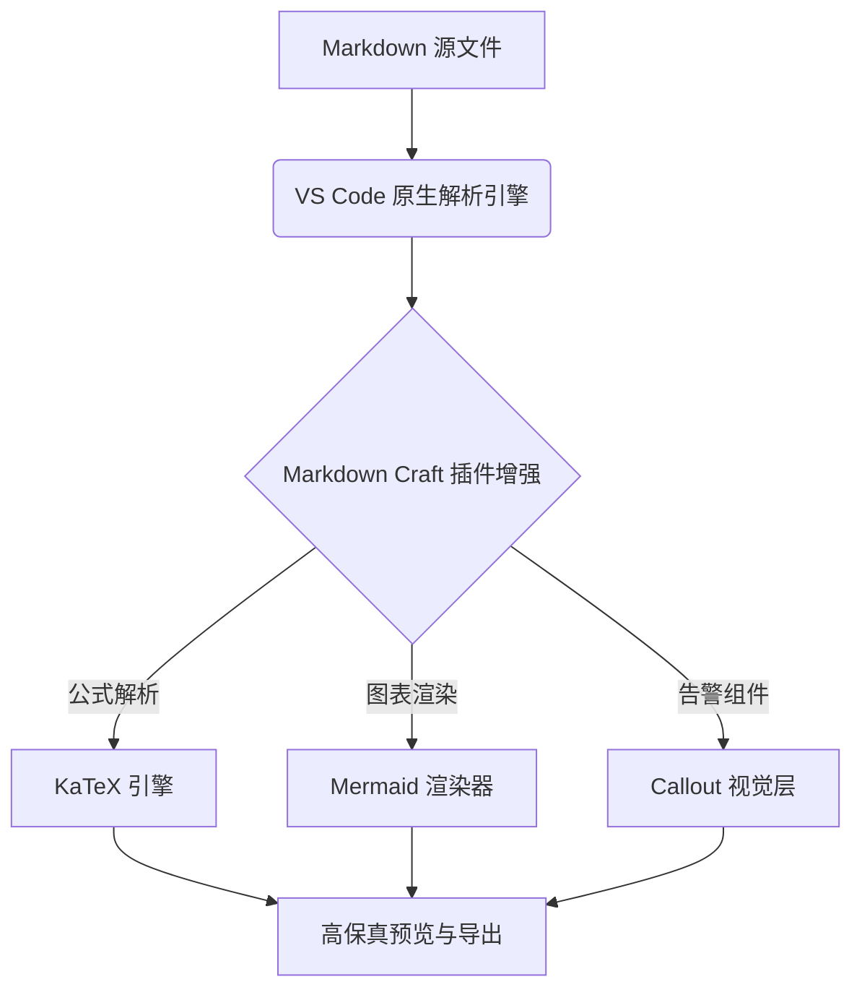
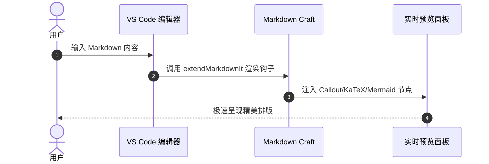

# 🌟 Markdown Craft 功能全景演示文档

> Markdown Craft 专为现代知识工作者与技术作者打造，深度集成 VS Code 原生预览与增强命令集。

<!-- TOC -->
- [🌟 Markdown Craft 功能全景演示文档](#markdown-craft-功能全景演示文档)
  - [1. 告警框 Callouts & 折叠面板](#1-告警框-callouts--折叠面板)
  - [2. 数学公式 KaTeX 支持](#2-数学公式-katex-支持)
  - [3. Mermaid 架构与流程图表](#3-mermaid-架构与流程图表)
  - [4. 表格自动排版与中英文对齐](#4-表格自动排版与中英文对齐)
  - [5. 行内高亮与键盘徽章](#5-行内高亮与键盘徽章)
  - [6. 音视频与富媒体嵌入](#6-音视频与富媒体嵌入)
  - [7. 任务列表交互](#7-任务列表交互)
<!-- /TOC -->

---

## 1. 告警框 Callouts & 折叠面板

> [!NOTE] 提示信息 (Note)
> 这是一条标准的笔记提示，支持深色与浅色主题自适应高亮。

> [!TIP] 实用技巧 (Tip)
> 使用快捷键 [[Alt+Enter]] 可以快速切换当前行的任务清单状态。

> [!IMPORTANT] 关键要点 (Important)
> 扩展无缝注入 VS Code 内置 Markdown 预览，无需打开沉重的第三方独立面板。

> [!WARNING] 警示注意事项 (Warning)
> 修改重要配置文件前，请务必提前提交版本控制。

> [!CAUTION] 危险操作 (Caution)
> 执行全盘重置命令可能会导致未保存的数据丢失。

> [!TIP]+ 默认展开的可折叠面板 (Collapsible +)
> 点击右侧箭头可以收起本面板。适合用于放置详细代码解析或参考延伸资料。

> [!NOTE]- 默认折叠的答案面板 (Collapsible -)
> 这里是隐藏的答案解析，点击标题展开查看完整内容。

---

## 2. 数学公式 KaTeX 支持

支持行内公式，例如爱因斯坦质能方程：$E = mc^2$，以及欧拉恒等式：$e^{i\pi} + 1 = 0$。

同时支持多行显示公式块：

$$
\int_{-\infty}^{+\infty} e^{-x^2} dx = \sqrt{\pi}
$$

以及矩阵线性方程组：

$$
\begin{pmatrix}
a & b \\
c & d
\end{pmatrix}
\begin{pmatrix}
x \\
y
\end{pmatrix}
=
\begin{pmatrix}
ax + by \\
cx + dy
\end{pmatrix}
$$

---

## 3. Mermaid 架构与流程图表

时序图示例：

---

## 4. 表格自动排版与中英文对齐

使用右键菜单或命令 `Markdown Craft: Auto Format Table`，即可将中英文混排、不同宽度的单元格精准按列对齐：

| 功能模块 | 对应快捷指令 | 支持特性 | 状态 |
| :--- | :---: | :--- | :---: |
| 目录生成 | `insertTOC` | 递归标题、锚点跳转、更新不丢失 | ✅ 支持 |
| 表格美化 | `formatTable` | 中英文全角/半角等宽对其 | ✅ 支持 |
| 盘古排版 | `formatPangu` | 中英文与数字优雅留白 | ✅ 支持 |
| 微信排版 | `exportWeChat` | 样式内联，100% 还原样式，免排版 | ✅ 支持 |
| HTML 导出 | `exportHTML` | 自包含单文件，公式图表离线可用 | ✅ 支持 |

---

## 5. 行内高亮与键盘徽章

- 高亮标注：这是 ==特别重要的核心结论==，一眼就能被识别。
- 下划线标记：这是 ++需要补充修订的内容++。
- 上标与下标：水的化学式是 H~2~O，计算面积是 100m^2^。
- 键盘胶囊徽章：按下 [[Ctrl+Shift+P]] 打开命令面板，或者按 [[Ctrl+K]] [[V]] 打开侧边栏实时预览。

---

## 6. 音视频与富媒体嵌入

音频播放控件：
@[audio](https://interactive-examples.mdn.mozilla.net/media/cc0-audio/t-rex-roar.mp3 "霸王龙音频示例")

---

## 7. 任务列表交互

- [x] 完成 Markdown-it 插件生态链整合
- [x] 实现 Obsidian 风格 Callout 告警框
- [x] 内置离线 KaTeX 数学公式支持
- [x] 内置 Mermaid 矢量流程图动态渲染
- [x] 提供中英文排版规范化（Pangu 自动空格）
- [x] 提供微信公众号一键排版富文本复制
- [ ] 享受极致 Markdown 写作体验！
